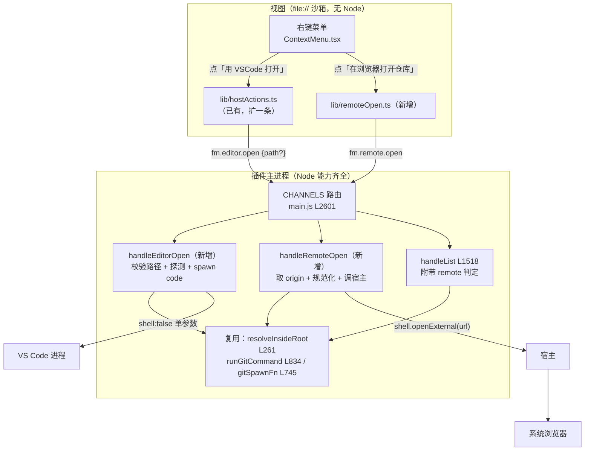

# 用 VSCode 打开 / 在浏览器打开仓库 —— 技术设计

Feature Name: open-in-editor-and-remote
Updated: 2026-10-12

## Description

给「文件管理器」（`pi.file-manager`）增加两个把目标**交给外部程序**的动作：

- **用 VSCode 打开**：把基点文件夹、某个文件或某个目录交给本机 VS Code 的命令行（`code`），`shell: false` 单个参数启动。
- **在浏览器打开仓库**：把 `origin` 远程地址规范化成 `https://` 形式的仓库首页，交给宿主的 `shell.openExternal`。

两者共享一个形状：**入口都在右键菜单**（文件 / 目录 / 空白处），**判定集中在主进程**，视图只负责渲染可用状态与失败提示。差别在于谁去执行——VSCode 必须由插件自己 spawn（宿主没有「用指定程序打开」的通道），浏览器必须由宿主执行（插件没有 `shell.openExternal` 之外的打开方式，而它恰好就在宿主 API 里）。

### 为什么 VSCode 不走宿主

宿主提供给插件的打开通道只有两条（`fs.openDefault` / `fs.reveal`），它们的作用是「用系统默认关联程序打开」。VS Code 不是 `package.json` 之外的任何文件类型的默认关联程序，而且 `fs.openDefault` 无法保证打开的是 VS Code。宿主 API 里也没有「用指定可执行文件打开某个路径」的通道，`shell.openExternal` 的白名单只放行 `http/https/mailto`（宿主 `parseAllowedExternalUrl`），`vscode://file/…` 这类自定义协议会被直接拒掉。所以唯一可行的路径是插件自己 spawn——这与 0.7.0 起 git 联动的做法一致（`main.js` 的 `gitSpawnFn` / `runGitCommand`，L745 / L834），那里已经验证过插件进程 `spawn` 可用。

因此 `manifest.json` 不需要为 VSCode 新增任何权限：进程能力是插件进程本来就有的 Node 能力，与 git 一样。

### 为什么浏览器必须走宿主

「在浏览器打开」= 让操作系统用默认浏览器打开一条 URL。插件主进程确实可以自己 `spawn("open"/"xdg-open"/"start")`，但那等于在插件里重新实现一份「打开外部链接」，跨平台分支多、且绕开了宿主的协议白名单。宿主已经提供了 `shell.openExternal`，它的白名单（仅 `http`/`https`/`mailto`）正是我们想要的第二道闸。代价是 `manifest.json` 要新增一项 medium 风险权限 `shell.openExternal`。

## Architecture



### 职责边界

| 层 | 职责 | 不做 |
|---|---|---|
| 视图 `lib/remoteOpen.ts` / `lib/hostActions.ts` | 把用户点击折算成一条通道调用；把失败折算成 Toast 文案 | 不解析远程地址、不探测 `code`、不判断 git |
| 主进程 `handleEditorOpen` | 校验路径 → 解析绝对路径 → 探测并 spawn `code` | 不碰 git、不拼 URL |
| 主进程 `handleRemoteOpen` | 取 origin → 规范化 → 调宿主 `shell.openExternal` | 不写仓库、不碰 `.git/**`、不自己发网络请求 |
| manifest | 只新增 `shell.openExternal` | 不新增 `fs.write` / `net.domains` |

### 1. manifest.json

```json
"permissions": ["ui.view", "fs.read", "shell.openExternal"],
```

`fs` 段保持不变（`read`: `root: "workspace"`, `scope: ["**"]`）。不新增 `net.domains`。

版本 `0.8.2` → `0.9.0`（新增用户可见能力，按仓库现有语义走 minor）。`i18n` 的 `description` 与 `safetyNotes`、`README.md`、`CHANGELOG.md` 同步补这两项能力与它们的边界说明。

### 2. 通道契约（`views-src/src/lib/rpc.ts`）

在 `channels`（L379）追加两条，并在同文件补类型（与既有 `Failure` L108 同形状）：

```ts
editorOpen: "fm.editor.open",
remoteOpen: "fm.remote.open",
```

```ts
/** 「用 VSCode 打开」。path 省略或为空字符串 = 基点文件夹自身。 */
export type EditorOpenRequest = { path?: string };

export type EditorOpenResponse =
  | { ok: true; path: string; binary: string }
  | Failure;

/** 「在浏览器打开仓库」。 */
export type RemoteOpenResponse =
  | { ok: true; url: string }
  | Failure;

/** fm.hello 追加的探测结果：视图据此决定菜单项是否可用。 */
export type EditorCapability = {
  /** 探测到的可执行文件路径；null = 没找到。 */
  binary: string | null;
};
```

`HelloResponse`（L151）追加 `editor: EditorCapability`。

`ListResponse` 追加 `remote: RemoteCapability`：

```ts
/** 「这个基点文件夹能不能打开仓库首页」；不能时给出原因键。 */
export type RemoteCapability =
  | { available: false; reason: RemoteReason }
  | { available: true; url: string; host: string };

export type RemoteReason =
  | "noRepo"        // 不是 git 仓库
  | "noRemote"      // 没有 origin
  | "notOpenable"   // 地址规范不成 http(s)
  | "noGit";        // 机器上没有 git
```

放在 `fm.list` 而不是 `fm.hello`，是因为它随**基点**变化（换文件夹就换仓库），而 `fm.list` 是唯一一次「基点已确定」的调用；`fm.list` 已经带 `git: GitSummary` 做同类事情，形状一致。

### 3. 主进程新增

#### 3.1 VS Code 探测：只认 `PATH`（Requirement 2）

探测**只在 `PATH` 上做**，不做任何安装位置兜底：

```js
/** PATH 里找 code（Windows 上是 code.cmd）；找不到返回 null。纯查找，不启动进程。 */
async function resolveEditorBinary() { … }
```

规则：

- 取 `process.env.PATH`，按平台分隔符（POSIX `:`、Windows `;`）切分，逐个目录找可执行文件。Windows 上找的是 **`code.cmd`**（大小写不敏感）。
- 命中判定：POSIX 用 `fs.access(binary, X_OK)`；Windows 上 `code.cmd` 没有执行位，`fs.stat` 判存在且是文件即可。**不真正启动进程**去问 `--version`——`code` 在 macOS / Linux 上是个 shell 脚本，为了探测而启动它纯属浪费。
- 探测结果（命中路径或 `null`）**按插件进程缓存一次**。这不只是省开销：插件进程的 `PATH` 在进程生命周期内不会变，所以缓存不会失效；用户改了 `PATH` 需要重新加载插件才生效——这一点写在错误提示与 README 里，别让人以为插件坏了。

**为什么不做兜底**（刻意的决策，不是遗漏）：把 `/Applications/Visual Studio Code.app/…`、`/snap/bin/code` 这类路径写死进插件，等于替用户猜他的环境；猜错时会出现「我明明改过 `PATH`，这插件还是打开了那个我已经删掉的 VS Code」这种没法解释的行为。`PATH` 是用户自己的契约，插件只读它、不绕过它。找不到时的正确做法是把话说清楚（Requirement 2.6），让用户去补 `PATH`。

**Windows 上为什么必须经 `cmd.exe`**：`code.cmd` 是批处理文件，Windows 的 `CreateProcess` 不能直接执行它——`spawn(codeCmd, [path], { shell: false })` 会以 `EINVAL` 失败。所以 Windows 分支显式启动 `cmd.exe`（`process.env.ComSpec` 优先，回退 `%SystemRoot%\System32\cmd.exe`）并传 `["/d", "/s", "/c", <命令串>]`。这是对「参数不经 shell」这条不变量的**明确让步**，代价与缓解措施都在 3.2 与不变量 2 里写死了：双引号包裹（Windows 文件名不允许 `"`，引号跳不出去）、`/d` 关 AutoRun、不传 `/v` 保持 `!` 为字面量，并拒绝含 `%` 的路径。POSIX 分支完全不受影响，仍是参数数组直传。

换来的好处是 Windows **开箱可用**：VS Code 的 Windows 安装程序默认把 `...\Microsoft VS Code\bin` 加进 `PATH`，那里就有 `code.cmd`，用户不必自己改 `PATH`（这正是选 `code.cmd` 而非 `Code.exe` 的实际收益——`Code.exe` 在安装根目录、通常不在 `PATH` 上）。

错误提示的形状（Requirement 2.6）：文案要点名 `PATH` 与 `code`，例如「`PATH` 里没有 `code` 命令，请把 VS Code 的命令行目录加入 `PATH` 后重新加载插件」——不要只说「找不到 VS Code」，那会把人引向「我明明装了」的死胡同。

#### 3.2 `handleEditorOpen`（Requirement 1）

```js
async function handleEditorOpen(payload) {
  // 省略 / 空串 = 基点文件夹自身（项目根）。allowRoot 让它通过 resolveInsideRoot。
  const target = typeof payload?.path === "string" ? payload.path : "";
  const { abs } = await resolveInsideRoot(target, { mode: "read", allowRoot: true });

  // Windows 上路径要交给 cmd.exe：%VAR% 在双引号内照旧展开，含 % 的路径直接拒掉。
  if (process.platform === "win32" && isUnsafeForCmd(abs)) {
    throw fail("EDITOR_UNSUPPORTED_PATH", "this path cannot be opened on Windows");
  }

  const binary = await resolveEditorBinary();
  if (!binary) throw fail("EDITOR_UNAVAILABLE", "the code command is not on PATH");

  await spawnDetached(binary, abs);
  return { ok: true, path: abs, binary };
}
```

`spawnDetached` 是唯一的分平台点，其中 Windows 那段命令串由**纯函数**拼，因此可以在任何平台上单测：

```js
/** Windows 上不能安全交给 cmd.exe 的路径：% 会被展开，双引号屏蔽不掉。 */
function isUnsafeForCmd(targetPath) {
  return targetPath.includes("%");
}

/** 拼交给 cmd.exe 的命令串。纯字符串函数。 */
function windowsCommandLine(codeCmdPath, targetPath) {
  return `"${codeCmdPath}" "${targetPath}"`;
}

function spawnDetached(binary, targetPath) {
  const spawn = gitSpawnFn();                     // 复用既有的惰性 require，与 git 一致
  if (!spawn) throw fail("EDITOR_UNAVAILABLE", "child processes are unavailable");

  const child =
    process.platform === "win32"
      ? spawn(comSpecPath(), ["/d", "/s", "/c", windowsCommandLine(binary, targetPath)], WINDOWS_OPTIONS)
      : spawn(binary, [targetPath], POSIX_OPTIONS);
  child.unref();
  return waitForSpawn(child);                     // 5s 超时兜底
}
```

要点：

- **复用 `resolveInsideRoot`**（L261）：它是全部通道的唯一入口守卫，已经负责规范化、根内包含、`.env*` / `.ssh` / `.pem` / `.git/**` 黑名单、symlink / junction 逃逸（realpath 双重校验）。这里传 `allowRoot: true`，因为「打开项目」的目标就是基点文件夹本身；`allowRoot` 默认 `false` 正是为了防止别的通道越权拿根。
- **POSIX 分支原样**：`spawn(binary, [abs], { detached: true, stdio: "ignore", windowsHide: true, shell: false })` + `unref()`，参数是数组，路径里的空格、`$(…)`、反引号、换行都只是普通字符。
- **Windows 分支的约束**：`shell: false` 仍留在 spawn 调用上（不让 Node 从参数数组拼命令串），命令串只由 `windowsCommandLine` 构造，内容就是两个双引号包裹的路径。`&`、`|`、`>`、`<`、`^` 在双引号内都是字面量；`/d` 关掉 AutoRun；不传 `/v`，延迟展开保持关闭，所以 `!` 也是字面量。唯一漏下的是 `%`，由 `isUnsafeForCmd` 提前拒掉。
- **`ComSpec` 兜底**：优先取 `process.env.ComSpec`，没有时回退 `<SystemRoot>\System32\cmd.exe`；两者都拿不到就按 `EDITOR_UNAVAILABLE` 失败，不猜别的解释器。
- **不等待进程**：`code.cmd` 自己会立刻退出（把请求转给已有实例），但即使它不退，`unref` 之后 5 秒内也一定返回。用 5 秒超时兜底：超时就判失败，但**不 kill**（进程已经交给系统了）。
- 目标可以是文件也可以是目录：`code <dir>` 打开文件夹、`code <file>` 打开文件，都是 VS Code 的既有语义。

#### 3.3 origin 取得与规范化（Requirement 4）

取 origin 用 git 的既有封装：

```js
const result = await runGitCommand(rootPath, ["remote", "get-url", "origin"], { maxBytes: 4096 });
```

`git remote get-url origin` 在 git ≥ 2.7 上可用（宿主 engines 要求 PI-Desktop ≥ 0.9.0，其 Electron 43 / Node 24 环境不存在更老的 git 顾虑）。它**只读**：不写配置、不联网、不碰 `.git/**` 的内容（git 自己会读，那是它的事）。

规范化是一个**纯函数**，因此可离线单测（这是本设计里最该被钉住的一段）：

```js
/**
 * origin 地址 → 仓库首页。返回 { ok: true, url } 或 { ok: false, reason }。
 * 不联网、不查 host 属于哪家托管服务——只做形态归一。
 */
function normalizeRemoteUrl(raw) { … }
```

规则（与 Requirement 4 的表一一对应）：

| 步骤 | 处理 |
|---|---|
| 1 | 含控制字符（`U+0000`–`U+001F`、`U+007F`）→ `notOpenable` |
| 2 | `scp` 形态 `user@host:path` → `https://host/path`（注意 `host:path` 与 `http://host:port` 的区分：`://` 之前不含 `/`、且冒号后不是纯数字，才按 scp 处理） |
| 3 | `ssh://` / `git://` → 换协议为 `https://`，**丢弃端口**（SSH 端口与 HTTPS 无关） |
| 4 | `http://` / `https://` → 原样保留协议与端口 |
| 5 | `file://`、裸本地路径（`/`、盘符、UNC 开头）→ `notOpenable` |
| 6 | 去掉结尾的 `/` 与结尾的 `.git` |
| 7 | 结果必须是可解析的 `http(s)` URL 且 host 非空，否则 `notOpenable` |

**刻意不猜平台**：不判断 host 是不是 `github.com` / `gitlab.com` / `bitbucket.org`，也不按平台生成不同的路径格式。既然链接只落到仓库首页，就不存在任何平台相关的路径拼接，自建 GitLab、Gitea、企业内网 git 全都自然可用。这是「只开首页」这个决策换来的最大简化。

#### 3.4 `handleRemoteOpen`（Requirement 3）

```js
async function handleRemoteOpen() {
  const root = await currentRoot();
  if (!root) throw fail("NO_WORKSPACE", "no project is open");

  const url = await remoteUrlFor(root.path);      // 内部判定 + 可能抛 NO_REPO / NO_REMOTE / GIT_UNAVAILABLE
  if (!url) throw fail("REMOTE_NOT_OPENABLE", "the origin remote is not a web address");

  await pi.shell.openExternal(url);
  return { ok: true, url };
}
```

- 只调 `pi.shell.openExternal(url)`——宿主侧会再过一遍 `parseAllowedExternalUrl`（只放行 `http`/`https`/`mailto`），拒绝时抛 `DISALLOWED_EXTERNAL_URL`，由 `toFailure` 统一折算成 `{ ok: false, code, message }`。
- `remoteUrlFor` 被 `handleRemoteOpen` 与 `handleList` 共用：`handleList` 拿它填 `ListResponse.remote`，让视图不必为渲染菜单再跑一次 git。

#### 3.5 `handleList` 增量（Requirement 4.11）

`handleList`（L1518）已经在末尾做了「取一次 git 快照、给每条 entry 挂 `git` 字段、返回 `git: summarizeGit(...)`」。同一处追加 `remote`：

```js
return {
  ok: true,
  path: rel,
  entries,
  truncated,
  ignoreActive: rules.length > 0,
  git: snapshot ? summarizeGit(snapshot) : { available: false },
  remote: await remoteCapabilityFor(rootPath, snapshot),   // 新增
};
```

`remoteCapabilityFor` 复用同一个 `snapshot`，避免在一个已经跑过 git 的调用里再跑第二个 git 进程：

- `snapshot === null` → `{ available: false, reason: "noRepo" }`（同时覆盖「没 git」与「不是仓库」两种成因；具体哪一种由 `gitBinary` / 探测结果区分，见 Error Handling）
- 快照有、但 origin 取不到 → `{ available: false, reason: "noRemote" }`
- origin 规范化失败 → `{ available: false, reason: "notOpenable" }`
- 成功 → `{ available: true, url, host }`

为控制成本：origin 与它的规范化结果**随 git 快照一起缓存**（同一 TTL 2s），并且「取 origin」这一步只在 `snapshot !== null` 时才发起。

### 4. 视图新增/改动

#### 4.1 `views-src/src/lib/hostActions.ts`（扩展）

既有两条（`openWithDefaultApp` / `revealInFileManager`）保持不动，追加：

```ts
/** 「用 VSCode 打开」。path 省略 = 基点文件夹自身。 */
export function openInEditor(path?: string): Promise<{ path: string; binary: string }>;
```

复用同一个 `runHostAction` 式的错误折算：`{ ok: false }` 与异常统一成 `throw`，调用方只写一个 `catch`。

#### 4.2 `views-src/src/lib/remoteOpen.ts`（新增）

```ts
/** 「在浏览器打开仓库」；返回实际打开的地址。 */
export function openRepoInBrowser(): Promise<{ url: string }>;
```

单独一个文件而不是塞进 `hostActions.ts`：`hostActions.ts` 的注释把「由宿主代为执行的两个动作」这件事写死了（`fs.openDefault` / `fs.reveal` 都受 `manifest.fs.read` 约束、都只对文件有效），而这条通道不受 `manifest.fs` 约束、也不只对文件有效，混在一起会把那份契约讲歪。

#### 4.3 `views-src/src/App.tsx`

- `runHostAction`（L990）旁新增 `runEditorOpen(path?: string)` 与 `runRemoteOpen()`。两者都直接调通道、失败走 `ui.showToast`（与既有两条一致，不占用插件的错误横幅——它们与「当前打开的文件」无关）。
- 菜单（`menuEntries`，L1016）在既有动作之后追加一组：

```ts
{ kind: "separator" },
{
  kind: "item",
  label: target ? t("openInVSCode") : t("openProjectInVSCode"),
  // 探测不到命令行时禁用，hint 说明原因（Requirement 6.3）。
  disabled: !editorAvailable,
  hint: editorAvailable ? undefined : t("editorUnavailable"),
  onPick: () => runEditorOpen(target ? target.path : undefined),
},
{
  kind: "item",
  label: t("openRemote"),
  disabled: !remote?.available,
  hint: remote?.available ? t("openRemoteHint", { host: remote.host }) : t(remoteReasonKey(remote?.reason)),
  onPick: () => runRemoteOpen(),
},
```

- **路径语义**：文件 / 目录送**基点相对路径**，也就是树里那个 `target.path` 原样送出去（与 `fm.read` / `fm.delete` 送 `entry.path` 完全一致）；主进程用唯一入口守卫 `resolveInsideRoot` 把它解析成绝对路径。**不要**用 `lib/roots.ts` 的 `hostActionPath`：那个函数是给**宿主代为执行**的 `fs.openDefault` / `fs.reveal` 用的（宿主的这两条通道只接受工作区相对路径、按主文件夹解析，所以基点不是主文件夹时必须送绝对路径），而本通道的路径由插件自己解析，送绝对路径会被 `resolveInsideRoot` 的 `normalizeRelative` 以 `ABSOLUTE_PATH` 拒掉（已实测）。Requirement 1.5 定的就是「视图送基点相对路径、主进程解析成绝对路径」这条约定。
- **项目根**：空白处右键时 `target` 为 `null`，此时**不传 `path`**，由主进程按基点文件夹解析。刻意不在视图侧拼基点路径：主进程那边的 `currentRoot()` 是唯一真相来源。
- `remote` 从 `loadDirectory` 的响应里取（`setRemote(response.remote)`），与既有的 `setGitSummary(response.git)` 完全同构，放在同一个 `useCallback` 里。

#### 4.4 `views-src/src/i18n.ts`

新增键（en / zh 两份，**键集合必须一一对应**，由 `verify-git.mjs` 的既有断言守住）：

| key | en | zh |
|---|---|---|
| `openInVSCode` | `Open in VS Code` | `用 VSCode 打开` |
| `openProjectInVSCode` | `Open project in VS Code` | `用 VSCode 打开项目` |
| `editorUnavailable` | `The code command is not on your PATH — add VS Code's bin directory to PATH, then reload the plugin.` | `PATH 里没有 code 命令，请把 VS Code 的命令行目录加入 PATH，然后重新加载插件。` |
| `editorOpenError` | `Could not open this in VS Code.` | `无法在 VSCode 中打开。` |
| `editorUnsupportedPath` | `This path cannot be opened on Windows: it contains "%", which cmd.exe would expand.` | `该路径含有 %，在 Windows 上会被 cmd.exe 展开，无法安全打开。` |
| `openRemote` | `Open repository in browser` | `在浏览器打开仓库` |
| `openRemoteHint` | `Open {host} in your browser` | `在浏览器中打开 {host}` |
| `remoteNoRepo` | `This folder is not a git repository.` | `这个文件夹不是 git 仓库。` |
| `remoteNoRemote` | `This repository has no "origin" remote.` | `这个仓库没有配置 origin 远程地址。` |
| `remoteNotOpenable` | `The origin remote is not a web address.` | `origin 远程地址不是网页地址，无法打开。` |
| `remoteNoGit` | `git was not found on this machine.` | `这台机器上找不到 git。` |
| `remoteOpenError` | `Could not open the repository in your browser.` | `无法在浏览器中打开仓库。` |

#### 4.5 `manifest.json` 的 `i18n`

`description` 增加一句：右键菜单可以把文件 / 目录 / 项目交给 VS Code 打开，或把 `origin` 对应的仓库首页交给浏览器打开。

`safetyNotes` 增加：VS Code 由**插件进程自己启动**（与 git 联动同一套机制，不是宿主网关），只传一个经根内包含校验与凭据黑名单的绝对路径；POSIX 上以参数数组直传、`shell: false`，**Windows 上 `code.cmd` 必须经 `cmd.exe`**，因此改用显式构造的命令串（两个路径各自双引号包裹、`/d` 关 AutoRun、不传 `/v`），并拒绝含 `%` 的路径（`%VAR%` 在双引号内也会展开）；两种分支都不把条目名、远程地址等其它字符串拼进任何命令；浏览器打开走宿主的 `shell.openExternal`，为此新增该权限（medium，宿主另有 http/https/mailto 白名单作为第二道闸），只送规范化后的 `http(s)` 地址、不送任何其它内容；新增的能力都不写文件、不写仓库、不联网（插件自己不发起任何请求）。

## Data Models

无持久化数据。`prefs` 不变——这两个动作没有可记住的状态（不像分栏宽度或 root 记忆）。新增的都是**派生的、可丢弃的**进程内状态：

```js
let editorBinary = undefined;  // undefined = 未探测；null = 探测过但没找到；string = 命中
let editorSpawn  = null;       // 懒拿的 child_process.spawn，同 gitSpawnFn 的写法
```

## Correctness Properties

1. **不变量：通道只接受基点内的路径。** `handleEditorOpen` 唯一的路径来源是 `resolveInsideRoot`，它在 `allowRoot: true` 时也只放行「基点文件夹自身」，任何越界 / 凭据路径 / symlink 逃逸都会在其内部抛出，进程根本不会启动。
2. **不变量：参数不经 shell；Windows 上经 `cmd.exe` 但引号不可逃逸。** POSIX 用 `spawn(binary, [abs], { shell: false })`，参数是数组而非字符串——条目名里的空格、`;`、`$()`、反引号、换行都不可能变成命令。Windows 上 `code.cmd` 必须经 `cmd.exe`（`CreateProcess` 不能直接执行批处理），因此改为显式构造命令串：两个路径各自双引号包裹（Windows 文件名不允许 `"`，跳不出引号），`/d` 关掉 AutoRun、不传 `/v` 保持 `!` 为字面量，并**拒绝含 `%` 的路径**（`%VAR%` 在双引号内照旧展开）。`shell: false` 在两种分支上都保留在 spawn 调用上，命令串只由本插件构造。
3. **不变量：送进 `shell.openExternal` 的只能是 `http`/`https` 绝对 URL。** 由 `normalizeRemoteUrl`（要求 host 非空）与宿主白名单两道独立校验保证，任一道单独失效也拦得住。
4. **不变量：只读。** 两个动作都不调用任何写通道；取 origin 走 `runGitCommand`，只跑 `remote get-url`，无索引写、无网络、无 `.git/**` 触碰。
5. **幂等：** 同一次点击重复到达（菜单双击、重试）最多重复启动一次外部程序，不改变插件自己的任何状态。
6. **失败不留半成品：** 两个动作都不写盘，因此不存在「部分完成」；失败时唯一的表现是一条 Toast。
7. **降级不牵连：** `editorBinary === null`、git 缺失、非仓库、无 origin 全都不影响列目录、读写、保存、删除、搜索、SQLite、文件监听——与 0.7.0 git 联动「没有 git 就只是没有状态」的既定原则一致。

## Error Handling

| 情形 | 检测点 | code | 用户看到 |
|---|---|---|---|
| `PATH` 上没有 `code` | `resolveEditorBinary()` → null | `EDITOR_UNAVAILABLE` | 菜单项禁用 + `editorUnavailable` 悬停提示（点名 `PATH` 与 `code`）；强行调用则 Toast `editorOpenError` |
| `code` 启动失败（探测后 PATH 变了 / 权限被拒） | `spawn` 的 `error` 事件（ENOENT / EACCES） | `EDITOR_UNAVAILABLE` | 同上 |
| 路径含 `%`（仅 Windows） | `isUnsafeForCmd(abs)` | `EDITOR_UNSUPPORTED_PATH` | Toast `editorUnsupportedPath`：说明该路径在 Windows 上无法安全交给 `cmd.exe` |
| 启动超时（> 5s 未返回） | 计时器 | `EDITOR_TIMEOUT` | Toast `editorOpenError`（**不 kill**：进程已交给系统） |
| 路径越界 / 凭据路径 / symlink 逃逸 | `resolveInsideRoot` | `ESCAPE` / `DENIED_PATH` / `SYMLINK_ESCAPE` | 走既有错误横幅（与其它文件操作的报错一致） |
| 不是 git 仓库 | `buildGitSnapshot` → null | `NO_REPO` | 菜单项禁用 + `remoteNoRepo` 提示 |
| 没有 origin | `git remote get-url origin` 非 0 退出 | `NO_REMOTE` | 菜单项禁用 + `remoteNoRemote` 提示 |
| origin 不是网页地址 | `normalizeRemoteUrl` → `notOpenable` | `REMOTE_NOT_OPENABLE` | 菜单项禁用 + `remoteNotOpenable` 提示 |
| 机器上没有 git | 既有 `GIT_UNAVAILABLE` | `GIT_UNAVAILABLE` | 菜单项禁用 + `remoteNoGit` 提示 |
| 宿主拒掉地址 | `shell.openExternal` 抛错 | 宿主原样透传 | Toast `remoteOpenError` |

**「没 git」与「不是仓库」的区分**：`buildGitSnapshot` 对两者都返回 `null`，单看快照区分不了。因此 `remoteCapabilityFor` 额外看一次探测结果：已经知道 `gitBinary === null`（探测失败）时给 `noGit`，否则给 `noRepo`。两种成因恰恰是用户最需要分清的两句话（「去装 git」vs「这个文件夹不是仓库」）。

`handleHello` 的 `editor` 字段与 `handleList` 的 `remote` 字段都是**尽力判定**：探测失败一律降级成「不可用 + 原因」，绝不让视图卡在加载态。

## Test Strategy

沿用本仓库既有的离线校验风格（`views-src/verify-*.mjs`，用桩宿主驱动真实 `main.js`，纯函数单测 + 端到端两/三层）。新增 `verify-remote.mjs`，挂进 `package.json` 的 `verify` 串联脚本，并在 `README.md` 的「校验」一节登记。

### 层 1：纯函数夹具（主力）

`normalizeRemoteUrl` 是这一版最该被钉死的一段，因为它的输入来自仓库里的字符串、输出直接进宿主。夹具至少覆盖：

- `git@github.com:owner/repo.git` → `https://github.com/owner/repo`
- `ssh://git@gitlab.com:2222/owner/repo.git` → `https://gitlab.com/owner/repo`（端口被丢弃）
- `git://github.com/owner/repo.git` → `https://github.com/owner/repo`
- `https://github.com/owner/repo.git` → `https://github.com/owner/repo`
- `http://git.internal:8080/owner/repo.git` → `http://git.internal:8080/owner/repo`（协议与端口都保留）
- 自建 GitLab：`git@gitlab.company.com:group/sub/repo.git` → `https://gitlab.company.com/group/sub/repo`（**多级路径原样保留**，不做任何平台判断）
- 结尾无 `.git`、结尾有 `/`、两者都有
- 本地路径 `/Users/x/repo`、`file:///srv/repo`、相对路径 → `notOpenable`
- 含控制字符（`\u0000`、`\u007f`、`\n`） → `notOpenable`
- 空串、纯 `-`、`owner/repo`（无 host） → `notOpenable`
- `https://github.com/owner/repo?x=1#y` 这类带查询串 / 锚点 → 丢弃它们（首页不该带别人的参数）

### 层 2：视图判定

- `t()` 文案键 en / zh 一一对齐（复用 `verify-git.mjs` 第 6 节既有断言的做法，直接把新键纳入检查）。
- 菜单可用性：给定 `{ editor: { binary: null } }` 与 `remote: { available: false, reason }` 的四种 reason，断言菜单项 `disabled` 与 `hint` 文案正确；给定可用值断言不再禁用。
- 「空白处右键 → 不带 path」与「文件右键 → 送基点相对路径 `target.path`」两条分支的路径参数断言；再补一条「送绝对路径必须被 `ABSOLUTE_PATH` 拒掉」（证明这条通道不接受绝对路径，输入面窄到只剩基点相对路径）。

### 层 3：端到端（桩宿主 + 真实 main.js）

- **路径校验**：`fm.editor.open` 传 `../outside.txt`、`.env`、`.ssh/id_rsa`、指向根外的 symlink → 全部拒绝，且假 `code` 脚本的日志文件**没有新增行**（证明未发生 spawn）。
- **参数安全**：建一个名字带空格、`;`、`$()`、反引号的目录，请求打开它，断言 spawn 收到的 `argv[1]` 与该名字**逐字节相等**，且 `options.shell === false`。
- **项目根**：`fm.editor.open` 不传 `path` → 断言目标等于基点文件夹的绝对路径。
- **探测降级**：把 `PATH` 指向一个不含 `code` 的空目录 → `fm.hello` 的 `editor.binary === null` 且 `fm.hello` 照旧成功返回（不让视图卡在加载态），`fm.editor.open` 返回 `EDITOR_UNAVAILABLE`；同时断言提示文案里出现 `PATH`（Requirement 2.6）。
- **不做兜底**：在机器确实装了 VS Code 的前提下（例如 macOS 上 `/Applications/Visual Studio Code.app` 存在）把 `PATH` 清空 → 断言仍判为未找到，证明插件没有绕过 `PATH` 去猜安装位置。
- **真实仓库**：临时仓库加 `origin` → `fm.list` 的 `remote.available === true` 且 url 正确；改 `origin` 为本地路径 → `available: false, reason: "notOpenable"`；删掉 `origin` → `noRemote`；非仓库目录 → `noRepo`。
- **宿主调用**：桩宿主记录 `shell.openExternal` 收到的 URL，断言它等于规范化结果、且只被调用一次；桩宿主拒绝时断言返回 `{ ok: false }` 而不是 `{ ok: true }`。
- **回归**：既有 `pnpm verify` 七个脚本必须全绿（`fm.list` 的响应形状变了，`verify-jail.mjs` / `verify-git.mjs` 里对 `fm.list` 的断言要跟着看一遍）。
- **Windows 命令串（纯函数，任何平台可跑）**：`windowsCommandLine("C:\\…\\code.cmd", "C:\\a b\\c.txt")` → 断言结果恰为 `"C:\…\code.cmd" "C:\a b\c.txt"`（两个路径各自被双引号包裹，空格不被拆成两个参数）；`isUnsafeForCmd` 对含 `%` 的路径返回 true、对普通路径（含空格与 `&`）返回 false。
- **Windows 分支的拒绝**：Windows 上 `fm.editor.open` 传含 `%` 的路径 → 返回 `EDITOR_UNSUPPORTED_PATH` 且未 spawn。真实调用只在 Windows 上跑；`isUnsafeForCmd` 的纯函数用例在所有平台都跑。
- **Windows 分支的实际启动**：仅在 Windows 上执行——断言 spawn 收到的可执行文件是 `cmd.exe`（`ComSpec`）、`argv` 恰为 `["/d", "/s", "/c", windowsCommandLine(codeCmd, abs)]`，且 `shell === false`。

### 门禁

- `pnpm typecheck`（`tsc --noEmit`）——`HelloResponse` / `ListResponse` / `channels` 的形状变更必须让类型检查通过。
- `pnpm verify`（七个既有 + 新的 `verify:remote`）。
- 手工冒烟（无自动化，因为要真起外部程序）：在真实面板里分别点四个入口各一次——文件、目录、项目根、浏览器；再在删掉 `origin` 后确认菜单项变为禁用且提示正确。

## References

[^1]: (File) - [`manifest.json`](../../manifest.json)：权限（L35）、fs 范围（L36）、i18n 与 safetyNotes。
[^2]: (File) - [`main.js`](../../main.js)：`resolveInsideRoot`（L261）、`GIT_TIMEOUT_MS`（L712）、`GIT_FALLBACK_BINARIES`（L721）、`gitSpawnFn`（L745）、`runGitCommand`（L834）、`buildGitSnapshot`（L946）、`handleList`（L1518）、`handleHello`（L2578）、`CHANNELS`（L2601）、`internals` 导出（L2660）。
[^3]: (File) - [`views-src/src/lib/rpc.ts`](../views-src/src/lib/rpc.ts)：通道契约唯一真相来源（`Failure` L108、`Prefs` L110、`HelloResponse` L151、`channels` L379）。
[^4]: (File) - [`views-src/src/lib/hostActions.ts`](../views-src/src/lib/hostActions.ts)：既有的两个宿主动作与错误折算写法。
[^5]: (File) - [`views-src/src/lib/roots.ts`](../views-src/src/lib/roots.ts)：`hostActionPath`（L219）/ `absolutePathOf`——基点不是主文件夹时改送绝对路径的既有结论。
[^6]: (File) - [`views-src/src/App.tsx`](../views-src/src/App.tsx)：`runHostAction`（L990）、`menuEntries`（L1016）。
[^7]: (File) - [`views-src/src/components/ContextMenu.tsx`](../views-src/src/components/ContextMenu.tsx)：菜单项已支持 `disabled`（L130）与 `hint`（L131 / L143），无需改动。
[^8]: (File) - [`views-src/src/i18n.ts`](../views-src/src/i18n.ts)：`COPY_TABLES`（L10），新增键必须 en / zh 对齐。
[^9]: (File) - [`views-src/verify-git.mjs`](../views-src/verify-git.mjs)：离线校验的三层结构与中英键位对齐断言（第 6 节）。
[^10]: (File) - [`README.md`](../../README.md)：功能清单、数据与安全、已知限制三节需要同步。
